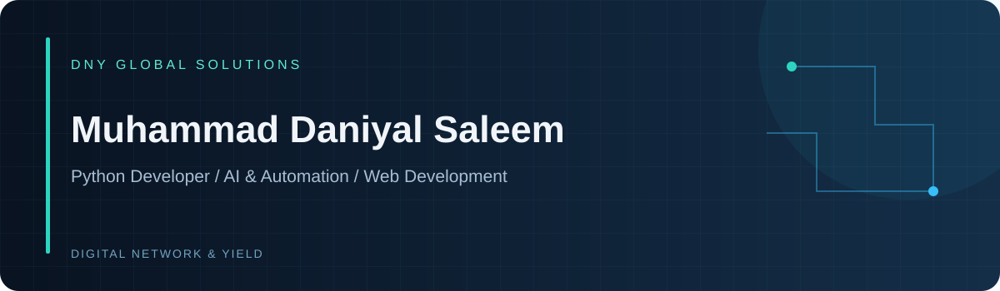
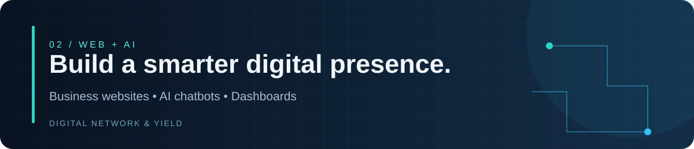
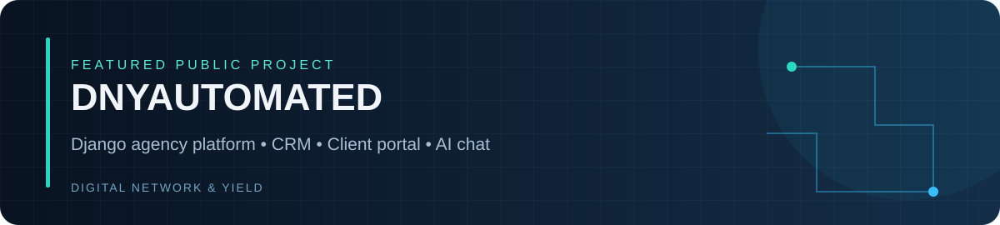

# Hi 👋 I'm Muhammad Daniyal Saleem

### Python • AI & Automation • Web Development • Digital Marketing

**Helping small businesses, agencies, and startups turn ideas into practical digital solutions.**

**DNY Global Solutions (SMC-Private) Limited**  
*Digital Network & Yield*

---

## 👨‍💻 About Me

I work with **Python, AI, automation, web development, and digital marketing**, with a focus on building useful solutions for everyday business needs. My interests include automating repetitive tasks, developing business websites, creating AI chatbots, and presenting information through clear dashboards.

Through **DNY Global Solutions**, I aim to help businesses in Pakistan and abroad improve their online presence and simplify their workflows.

- 🔭 **Current focus:** Business websites, automation tools, and AI-powered applications.
- 🤝 **Open to collaboration:** Python automation, chatbots, web applications, dashboards, and business tools.
- 🌱 **Currently exploring:** AI integrations, API-driven workflows, and scalable web applications.
- 💬 **Ask me about:** Python, website development, task automation, and digital marketing.
- ⚡ **What drives me:** Turning a repetitive process or a business idea into something useful.

## 🛠️ Tech Stack

**Areas of focus:** AI integrations · Workflow automation · Web scraping · Dashboards · Digital marketing

## 🚀 What I Can Help With

| Service | Focus |
| --- | --- |
| Python Automation | Scripts that reduce repetitive manual work |
| AI Chatbots | Business enquiries, service guidance, and website assistance |
| Website Development | Responsive business websites and web applications |
| Web Scraping & Data Processing | Collecting and organizing publicly available data |
| Dashboards & Business Tools | Clear interfaces for everyday operations and reporting |
| Digital Marketing | Online presence, content, and campaign support |

## 📂 Selected Public Repositories

### [DNYAUTOMATED](https://github.com/MuhammadDaniyalSaleem/DNYAUTOMATED)
A Django agency website with service pages, lead capture, a CRM workflow, client and staff dashboards, and a backend chatbot with optional Gemini integration.

### Explore More
[MetalLedger](https://github.com/MuhammadDaniyalSaleem/MetalLedger) · [DigiCard](https://github.com/MuhammadDaniyalSaleem/DigiCard) · [WestDebt-project](https://github.com/MuhammadDaniyalSaleem/WestDebt-project)

## 🌐 Let's Connect

Have a project, a workflow to automate, or an idea to build?  
📧 **[daniyalsaleem0024@gmail.com](mailto:daniyalsaleem0024@gmail.com)**

---

**DNY Global Solutions · Digital Network & Yield**  
*Building useful digital solutions, one project at a time.*

