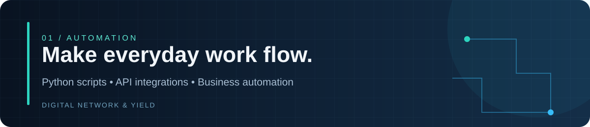
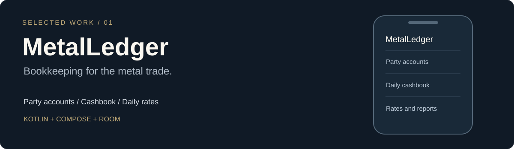
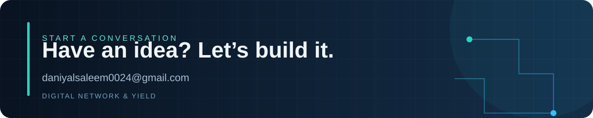

# Hi 👋 I'm Muhammad Daniyal Saleem

### Python • AI & Automation • Web Development • Digital Marketing

**Helping small businesses, agencies, and startups turn ideas into practical digital solutions.**

**DNY GLOBAL SOLUTIONS (SMC-Private) Limited**  
*Digital Network & Yield*

---

## 👨‍💻 About Me

I work with **Python, AI, automation, web development, and digital marketing**, with a focus on building useful solutions for everyday business needs. My interests include automating repetitive tasks, developing business websites, creating AI chatbots, and presenting information through clear dashboards.

I run **DNY GLOBAL SOLUTIONS (SMC-Private) Limited**, my company focused on software development, AI automation, web solutions, and digital marketing. Through DNY GLOBAL SOLUTIONS, I help businesses in Pakistan and abroad improve their online presence and simplify their workflows.

## 🏢 My Company — DNY GLOBAL SOLUTIONS

**DNY GLOBAL SOLUTIONS (SMC-Private) Limited**  
*Digital Network & Yield*

We build practical digital solutions for small businesses, agencies, and startups: business websites, AI chatbots, workflow automation, dashboards, and digital marketing support.

📩 **Business enquiries:** [daniyalsaleem0024@gmail.com](mailto:daniyalsaleem0024@gmail.com)

- 🔭 **Current focus:** Business websites, automation tools, and AI-powered applications.
- 🤝 **Open to collaboration:** Python automation, chatbots, web applications, dashboards, and business tools.
- 🌱 **Currently exploring:** AI integrations, API-driven workflows, and scalable web applications.
- 💬 **Ask me about:** Python, website development, task automation, and digital marketing.
- ⚡ **What drives me:** Turning a repetitive process or a business idea into something useful.

## 🛠️ Tech Stack

### Languages & Frontend

### Backend & APIs

### Mobile Development

### Databases & Background Tasks

### AI & Document Automation

### Version Control & Deployment

**Areas of focus:** AI integrations · Workflow automation · Web scraping · Dashboards · Digital marketing

## 🚀 What I Can Help With

| Service | Focus |
| --- | --- |
| Python Automation | Scripts that reduce repetitive manual work |
| AI Chatbots | Business enquiries, service guidance, and website assistance |
| Website Development | Responsive business websites and web applications |
| Web Scraping & Data Processing | Collecting and organizing publicly available data |
| Dashboards & Business Tools | Clear interfaces for everyday operations and reporting |
| Digital Marketing | Online presence, content, and campaign support |

## 📂 Selected Projects

### [MetalLedger](https://github.com/MuhammadDaniyalSaleem/MetalLedger)
An Android bookkeeping app for the metal trade. It brings party balances, payments, expenses, cashbook entries, and daily purchase/sale rates into one place.

- Gross, tare, and net weight calculations for transactions.
- Party statements as PDFs, with sharing through Android.
- JSON backup and restore, including support for older backups.
- Built with **Kotlin, Jetpack Compose, Room, and WorkManager**.

[View source →](https://github.com/MuhammadDaniyalSaleem/MetalLedger)

---

### [DigiCard](https://github.com/MuhammadDaniyalSaleem/DigiCard)
A React Native app project using React Navigation, Axios, bottom sheets, and Lottie. It represents another side of my work: building mobile interfaces with JavaScript.

**React Native · JavaScript · React Navigation · Axios**

[View source →](https://github.com/MuhammadDaniyalSaleem/DigiCard)

## 🌐 Let's Connect

Have a project, a workflow to automate, or an idea to build?  
📧 **[daniyalsaleem0024@gmail.com](mailto:daniyalsaleem0024@gmail.com)**

---

**DNY GLOBAL SOLUTIONS · Digital Network & Yield**  
*Building useful digital solutions, one project at a time.*

